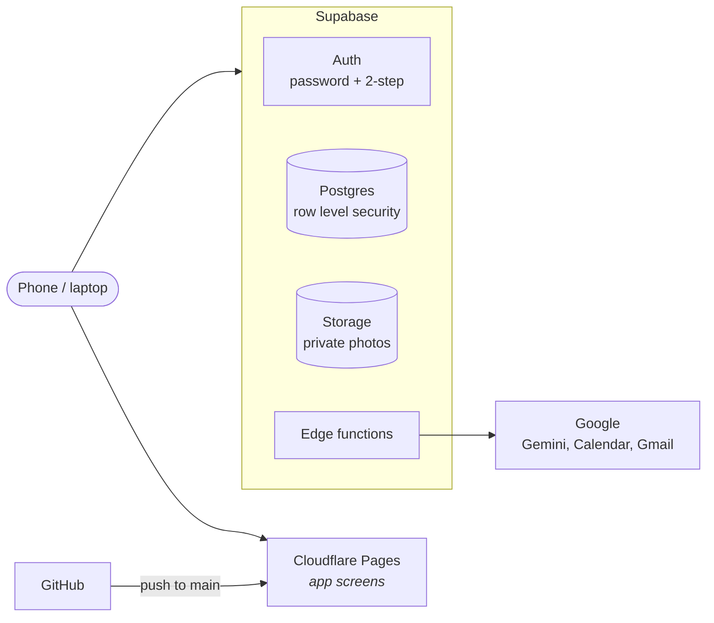

<p align="center">
  
</p>

<p align="center">
  <b>The little back office behind Reloved.Market</b><br>
  A private web app I use to plan, list and post for my preloved shop in Malaysia.
</p>

<p align="center">
  
  
  
  
  
</p>

---

## Why I made this

I sell secondhand furniture, electronics and home stuff on Carousell ([@relov3d.market](https://www.carousell.com.my/u/relov3d.market/)) and Facebook Marketplace. My plans were in Google Calendar, prices were in my head, listings were in Carousell and my Threads ideas were in my notes app. Too many places.

So I built one app that keeps all of it together, works on my phone and laptop, and costs nothing to run. It's only for me and my partner, so there's no sign up and everything sits behind a login with 2-step verification.

> This repo is public so people can see how it's built. The live app and all the shop data stay private.

## What it does

| | |
|---|---|
| **Home** | Shop totals (sold, for sale) and four "folders" for planning, listings, price check and Threads. |
| **Planner** | Month calendar with meetups, events and things to post. Tasks sync to Google Calendar. |
| **Listings** | All my items with photos, prices, condition and status. Add or edit by hand, or tap *AI help* to get a title, description and a fair RM price from a photo. |
| **AI price check** | Snap a photo and get a price range based on the Malaysian secondhand market. |
| **Threads ideas** | Write a rough idea, get it rewritten as a Threads post with hashtags, then plan it for a day of the week. |
| **Daily email** | Every morning at 7:40am I get an email with today's tasks, posts and what's still for sale. |
| **Shared shop** | My partner logs in with her own account and sees the same shop. |

It's built phone-first (fits the notch and home bar, can be added to the home screen like an app) and has a wider layout on laptop with hover effects.

## How it fits together



The screens are a static React build served by Cloudflare. Once it loads, the app talks straight to Supabase for login and data. Anything that needs a secret key (AI, Google Calendar, sending email) runs in Supabase edge functions, so no keys ever reach the browser.

More detail, with the login flow, calendar sync, daily email and database tables, is in **[docs/architecture.md](docs/architecture.md)**.

## Built with

- **Front end:** React 18, Vite 6, plain CSS (no UI library), hash router
- **Back end:** Supabase (Postgres, Auth with TOTP, Storage, Edge Functions on Deno, pg_cron)
- **AI:** Google Gemini (free tier), with retry and fallback models
- **Integrations:** Google Calendar API, Gmail API (OAuth)
- **Hosting:** Cloudflare Pages, deployed on every push to `main`

## Project structure

```
src/
  pages/          Home, Planner, Listings, Threads, Settings, Login
  components/     tab bar, bottom sheet, icons, toggle, toast
  lib/            supabase client, data store, helpers, mouse tilt
  styles.css      all the styling (phone first, laptop at 900px+)
supabase/
  functions/      ai-listing, ai-threads, gcal, gcal-callback, daily-email
  migrations/     tables, security rules, cron job
public/           icons, logo, Cloudflare headers and redirects
docs/             architecture and security notes
```

## Running it yourself

You need Node.js 20+ and your own free Supabase project.

```bash
git clone https://github.com/imanzackrie/reloved-market-app.git
cd reloved-market-app
npm install
cp .env.example .env      # put your Supabase URL and publishable key here
npm run dev
```

Open http://localhost:5173.

To set up the back end:

1. Run the files in `supabase/migrations` in order (Supabase SQL editor or `supabase db push`).
2. Deploy the functions in `supabase/functions` (`supabase functions deploy <name>`). `gcal-callback` and `daily-email` use `--no-verify-jwt` because they check their own secrets.
3. Add these secrets in **Edge Functions → Secrets**:

| Secret | What it's for |
|---|---|
| `GEMINI_API_KEY` | Free key from Google AI Studio, for the price check and Threads rewrite |
| `GOOGLE_CLIENT_ID`, `GOOGLE_CLIENT_SECRET` | Google Cloud OAuth client, for Calendar and Gmail |
| `ALLOWED_ORIGIN` | Your live site link |
| `GEMINI_MODEL` | Optional, to pick a different Gemini model |

4. In **Authentication**, turn off new sign ups and add users yourself.

## Deploying

Cloudflare Pages is connected to this repo:

- Build command: `npm run build`
- Output folder: `dist`
- Framework preset: React (Vite)

Every push to `main` goes live in about a minute. Shop data lives in Supabase, so adding listings or tasks never needs a deploy. Only code changes do.

## Security

Short version: 2-step login for everyone, row level security on every table, private photo storage, secrets only on the server, strict security headers, and no public sign up. The full write-up is in **[docs/security.md](docs/security.md)**.

## What's next

- [ ] Post to Threads straight from the app (right now it opens Threads with the text ready)
- [ ] Simple sales chart by month
- [ ] Carousell and Facebook don't allow posting from other apps, so that stays copy caption + open link for now

## License

All rights reserved. The code is here for people to read and learn from. Please don't reuse the Reloved.Market name, logo or artwork.

---

<p align="center">Made in Malaysia by <a href="https://github.com/imanzackrie">imanzackrie</a> · Reuse. Recycle. Reloved.</p>
