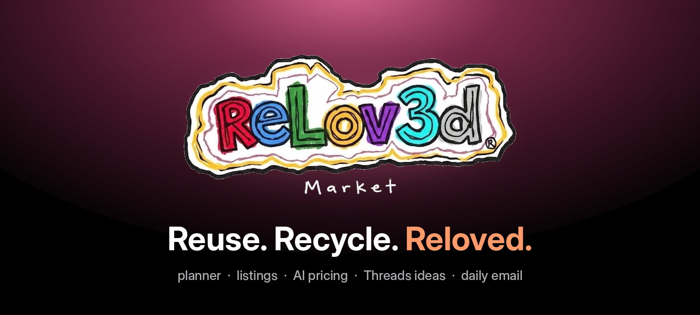
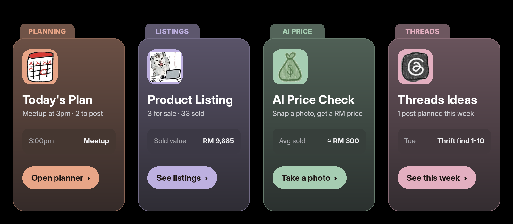
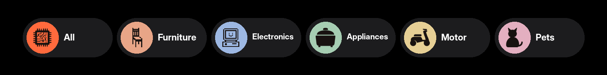
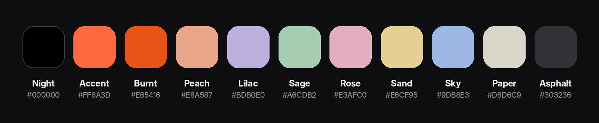

<p align="center">
  
</p>

<p align="center">
  <b>A street-style back office for a small preloved shop.</b><br>
  Planning, listings, AI pricing and Threads ideas in one place, on phone and laptop.
</p>

<p align="center">
  
  
  
  
  
</p>

---

## The story

I'm a tech guy who's really into street culture. Together with my partner I run **Reloved.Market**, a preloved shop in Malaysia selling secondhand furniture, electronics, home stuff and more on Carousell ([@relov3d.market](https://www.carousell.com.my/u/relov3d.market/)), Facebook Marketplace and Threads.

Running a small shop sounds simple until you count how many apps it takes. Plans in Google Calendar, listings tracked in Notion, drafts sent to each other on WhatsApp, prices guessed from memory and Threads ideas scribbled at midnight. Things got lost all the time.

So I built our own app. Every feature below started as a real problem we kept running into.

> This repo is public so people can see how it's built. The live app and all our shop data stay private.

## Problems we had, and what we built

### 1. Files everywhere → the Home "folders"

I always had to compile our stuff into files and then go and **find them physically**. That habit is where the Home screen came from: four folders stacked like a real file box (Planning, Listings, AI Price, Threads). Each one shows what's inside at a glance, and you tap it to open it, just like pulling a folder out of a drawer. Nothing to dig for anymore.

### 2. "What do we post tonight?" → Threads ideas with AI

Every single night we struggled to find a good topic for Threads and had to think up an idea from zero. Now we jot down a rough idea, even half a sentence, and the AI turns it into a proper Threads post in casual Malaysian English with hashtags that fit. Then we drop it onto a day of the week so the whole week is planned in one go.

### 3. Notion + WhatsApp for listings → one connected listing flow

We used to track listings in Notion (what's for sale, what's sold) and draft captions by sending them to each other on WhatsApp. Now listing and posting live together: add an item with a photo, tap **AI help** for a title, description and fair RM price, keep it as a draft, and mark it posted or sold. Everything stays connected, so the totals on Home update by themselves and nobody has to open WhatsApp to draft.

### 4. Forgetting today's schedule → Planner + Google Calendar + daily email

I kept forgetting what was on for the day. The Planner shows meetups, events and posting plans on a calendar, syncs every task to Google Calendar, and sends a summary to our company email **every morning at 7:40am**. So the plan finds me, instead of me having to look for it.

### 5. Coming soon → smart tracker + POS

Next up is a **smart money tracker** and a simple **POS system**, so every sale is recorded properly and it's easier for us to keep tax records ready for Malaysia's **e-invoice (LHDN MyInvois)**.

## Design

<p align="center">
  
</p>

I designed the app myself. The idea was to show that a business tool doesn't have to look like a spreadsheet. It can have the same **street and indie vibe** as the shop itself and still make the work easier.

- **Hand-drawn identity.** The ReLov3d logo, the doodle icons for each folder and the pixel-style category icons are all hand-made, not stock.
- **Folders you can feel.** Rounded cards with tabs, stacked like a real file box. On laptop they pop out when your mouse passes over them; on phone they lift gently one by one as you scroll.
- **Dark base, soft colours.** Black like a night street, with dusty pastel folders and one loud orange accent for what matters.
- **Small motion, not noise.** The tab bar's highlight slides between pages, icons bounce a little when tapped, and everything respects "reduce motion".
- **Phone first.** Built to sit on the home screen like a real app, fitting the notch and home bar, with a wider layout on laptop.

<p align="center">
  
</p>

<p align="center">
  
</p>

**Type:** the phone's own system font (SF Pro / Inter) for the interface, Bricolage Grotesque for the big "Reuse. Recycle. Reloved." line on the login page.

## Not just for us

We built this for Reloved.Market, but the problems aren't ours alone. Most small shops juggle the same mess of apps for planning, stock, pricing and social posts. The idea behind this project works for **SMEs anywhere in the world**: one simple, good-looking place that keeps the daily work connected, runs on free tools, and has a bit of personality.

## What it does

| | |
|---|---|
| **Home** | Shop totals (sold, for sale) and the four folders. |
| **Planner** | Month calendar with meetups, events and posting plans. Tasks sync to Google Calendar. |
| **Listings** | Items with photos, prices, condition and status. Add or edit by hand, or tap *AI help*. |
| **AI price check** | Snap a photo and get a price range for the Malaysian secondhand market. |
| **Threads ideas** | Rough idea in, Threads post and hashtags out, planned across the week. |
| **Daily email** | 7:40am summary of today's tasks, posts and stock, sent to the company inbox. |
| **Shared shop** | My partner has her own login and sees the same shop. |

## How it fits together


The screens are a static React build served by Cloudflare. Once it loads, the app talks straight to Supabase for login and data. Anything that needs a secret key (AI, Google Calendar, sending email) runs in Supabase edge functions, so no keys ever reach the browser.

More detail, with the login flow, calendar sync, daily email and database tables, is in **[docs/architecture.md](docs/architecture.md)**.

## Built with

- **Front end:** React 18, Vite 6, plain CSS (no UI library), hash router
- **Back end:** Supabase (Postgres, Auth with TOTP, Storage, Edge Functions on Deno, pg_cron)
- **AI:** Google Gemini (free tier), with retry and fallback models
- **Integrations:** Google Calendar API, Gmail API (OAuth)
- **Hosting:** Cloudflare Pages, deployed on every push to `main`

## Project structure

```
src/
  pages/          Home, Planner, Listings, Threads, Settings, Login
  components/     tab bar, bottom sheet, icons, toggle, toast
  lib/            supabase client, data store, helpers, mouse tilt
  styles.css      all the styling (phone first, laptop at 900px+)
supabase/
  functions/      ai-listing, ai-threads, gcal, gcal-callback, daily-email
  migrations/     tables, security rules, cron job
public/           icons, logo, Cloudflare headers and redirects
docs/             architecture and security notes
```

## Running it yourself

You need Node.js 20+ and your own free Supabase project.

```bash
git clone https://github.com/imanzackrie/reloved-market-app.git
cd reloved-market-app
npm install
cp .env.example .env      # put your Supabase URL and publishable key here
npm run dev
```

Open http://localhost:5173.

To set up the back end:

1. Run the files in `supabase/migrations` in order (Supabase SQL editor or `supabase db push`).
2. Deploy the functions in `supabase/functions` (`supabase functions deploy <name>`). `gcal-callback` and `daily-email` use `--no-verify-jwt` because they check their own secrets.
3. Add these secrets in **Edge Functions → Secrets**:

| Secret | What it's for |
|---|---|
| `GEMINI_API_KEY` | Free key from Google AI Studio, for the price check and Threads rewrite |
| `GOOGLE_CLIENT_ID`, `GOOGLE_CLIENT_SECRET` | Google Cloud OAuth client, for Calendar and Gmail |
| `ALLOWED_ORIGIN` | Your live site link |
| `GEMINI_MODEL` | Optional, to pick a different Gemini model |

4. In **Authentication**, turn off new sign ups and add users yourself.

## Deploying

Cloudflare Pages is connected to this repo:

- Build command: `npm run build`
- Output folder: `dist`
- Framework preset: React (Vite)

Every push to `main` goes live in about a minute. Shop data lives in Supabase, so adding listings or tasks never needs a deploy. Only code changes do.

## Security

Short version: 2-step login for everyone, row level security on every table, private photo storage, secrets only on the server, strict security headers, and no public sign up. The full write-up is in **[docs/security.md](docs/security.md)**.

## What's next

- [ ] Smart money tracker for sales, costs and profit
- [ ] Simple POS for recording sales on the spot
- [ ] E-invoice ready records for LHDN MyInvois
- [ ] Post to Threads straight from the app (right now it opens Threads with the text ready)
- [ ] Carousell and Facebook don't allow posting from other apps, so that stays copy caption + open link for now

## License

All rights reserved. The code is here for people to read and learn from. Please don't reuse the Reloved.Market name, logo or artwork.

---

<p align="center">Made in Malaysia by <a href="https://github.com/imanzackrie">imanzackrie</a> · Reuse. Recycle. Reloved.</p>
