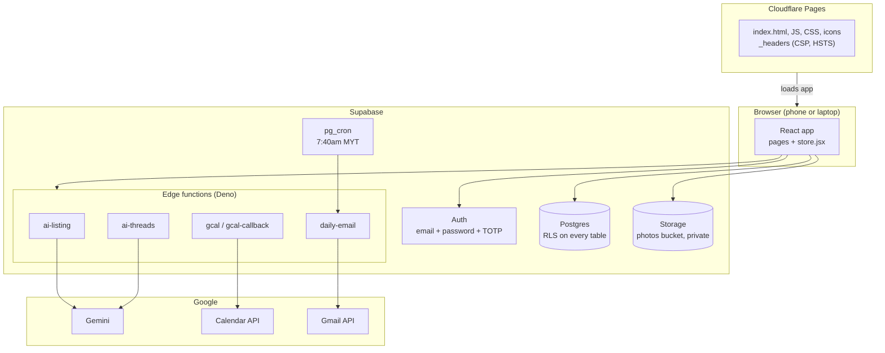
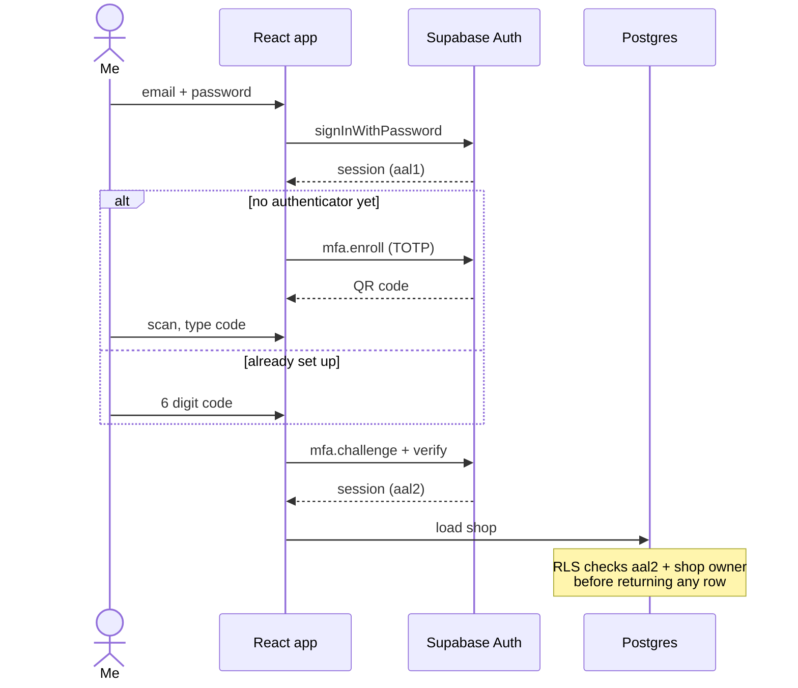
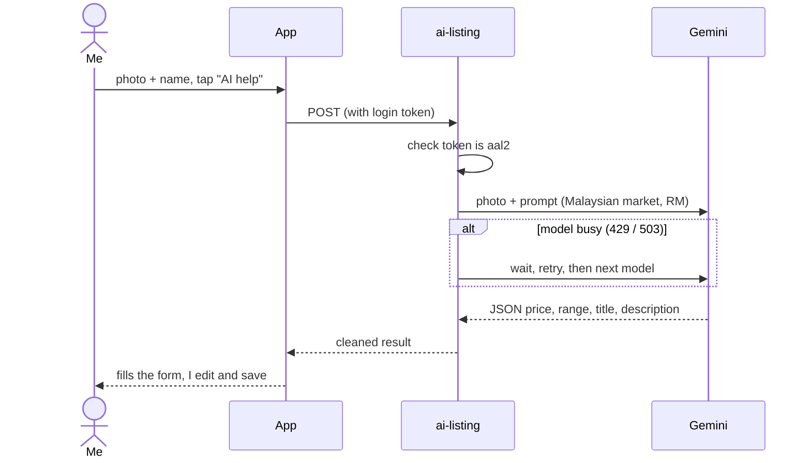
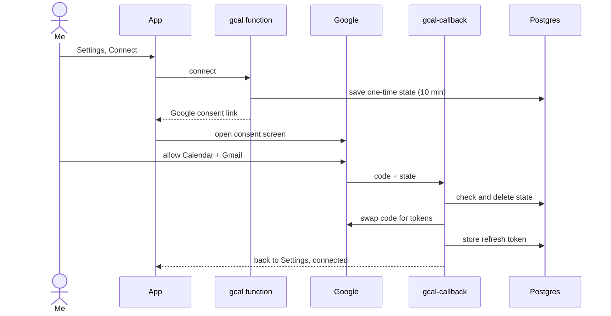
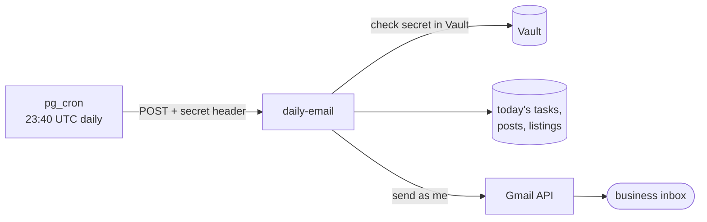
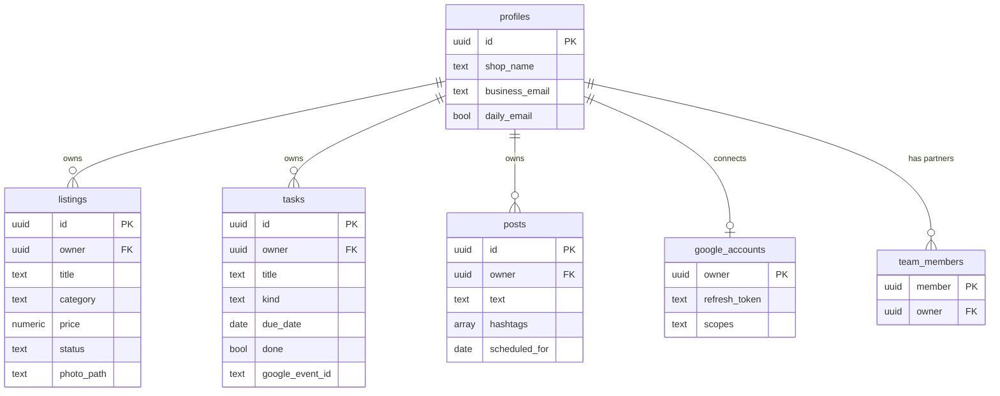
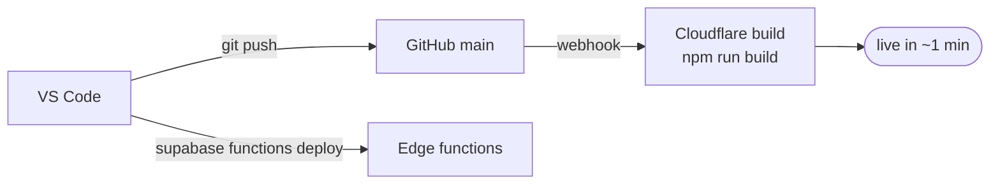

# Architecture

How the pieces of Reloved.Market talk to each other. Diagrams are written in Mermaid so GitHub draws them.

- [Overview](#overview)
- [Logging in](#logging-in)
- [Loading the shop](#loading-the-shop)
- [AI help on a listing](#ai-help-on-a-listing)
- [Google Calendar sync](#google-calendar-sync)
- [Daily email](#daily-email)
- [Database](#database)
- [Shared shop for partners](#shared-shop-for-partners)
- [Deploying changes](#deploying-changes)

## Overview

There's no server of my own. Cloudflare only hands out static files, and Supabase does login, data, files and the few bits of server code. The browser only ever holds the **publishable** Supabase key, which can't do anything the database rules don't allow.

## Logging in

Every account needs a password and a 6 digit code from an authenticator app. The session only counts as fully logged in (`aal2`) after the code.

There's no sign up page and no "forgot password". New users are added by hand in the Supabase dashboard, and sign ups are switched off on the Supabase side too.

## Loading the shop

`src/lib/store.jsx` holds everything the pages need. On login it:

1. asks the database who the shop owner is (`shop_owner()`, so a partner gets the main shop)
2. loads the profile, listings, tasks and posts
3. turns photo paths into short lived signed links
4. checks if Google is connected

Pages read from the store and call its functions (`addTask`, `updateListing` and so on). Every change goes straight to Supabase and updates the screen right away, so there's no save button.

## AI help on a listing

The AI never saves anything by itself. It only fills the form, and I decide what to keep. `ai-threads` works the same way for Threads posts and hashtags.

## Google Calendar sync

Connecting is a normal Google OAuth flow. The refresh token is kept in `google_accounts`, a table the browser can't read at all.

After that, adding, editing, ticking or deleting a task with "Google Calendar" on calls `gcal` to create, move or remove the matching event. Done tasks get a ✓ in front. Events I make directly in Google show in the planner as blue rows.

## Daily email

The cron job runs inside Supabase, so the email goes out even when my laptop is off. The secret it sends is random, made when the migration ran, and only lives in Supabase Vault. The function also skips anyone who already got today's email, so it never sends twice.

## Database

There's also a small `oauth_states` table for the one-time Google login states. The full SQL is in `supabase/migrations`.

## Shared shop for partners

A partner is just a row in `team_members` that points their user id at the owner's. The function `shop_owner()` returns the owner's id for a partner, or your own id if you're not a partner. Every policy compares rows to `shop_owner()`, and new rows default to it, so both of us read and write the same shop without any extra code in the app.

## Deploying changes

Data never needs a deploy. Only code changes do.
